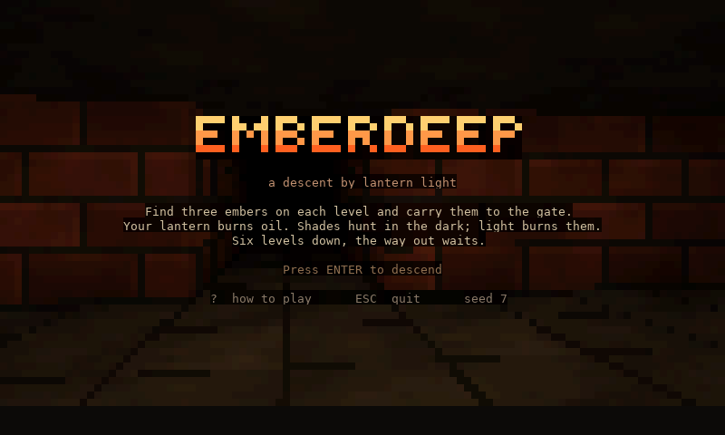
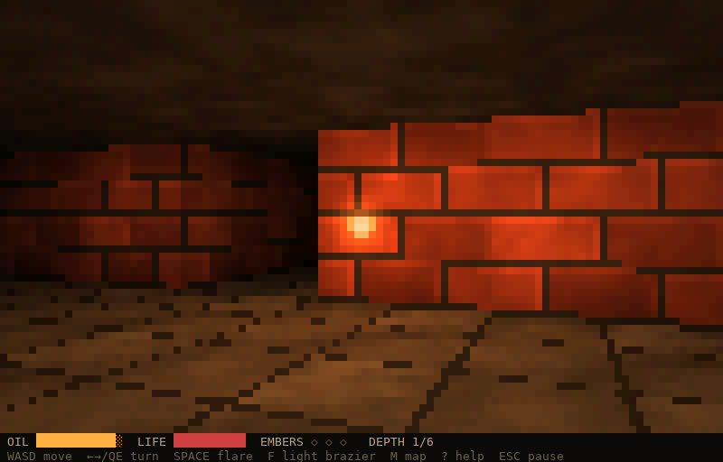
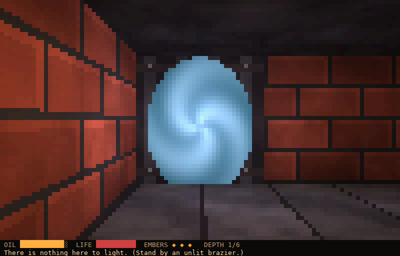
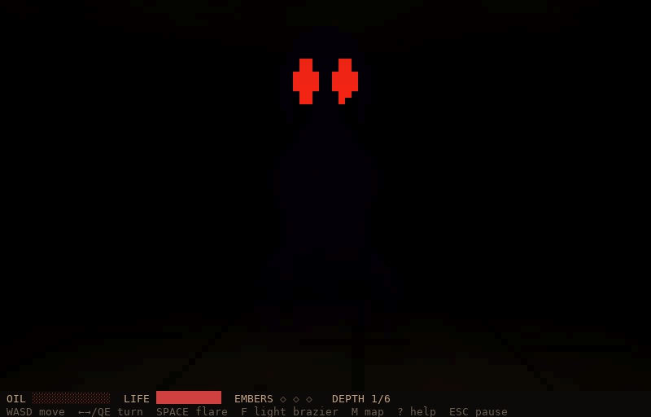
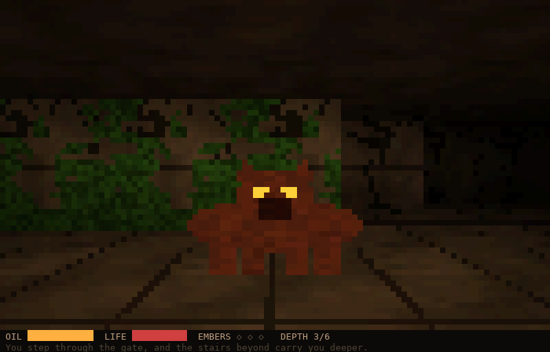

# Emberdeep

*A first-person descent by lantern light, in true-colour terminal graphics, written in Om.*



You go down into the mountain with a lantern and nothing else. On each of six
levels, three embers glow somewhere in the dark; carry all three to the sealed
gate and it opens onto the stairs down. Your lantern burns oil the whole time.
Shades drift through the rock toward you and drain your life; light burns
them, so they wait at its edge, and as your oil runs low the edge comes closer.
Deeper down, hounds hunt you by smell. Past the sixth gate is the way out.

| | |
|---|---|
|  |  |
|  |  |

## Run it

You need the Om compiler (see the [main README](../../README.md)) and a
terminal with true colour and at least 80x24: any modern terminal on Linux or
macOS, or **Windows Terminal** on Windows (see [Om on Windows](../../docs/windows.md)).
A bigger window gives a sharper picture; the view fills whatever size you give it.

```sh
om run games/emberdeep/emberdeep.om            # a new level layout every time
om run games/emberdeep/emberdeep.om 1234       # the same levels for seed 1234
```

Or build a native executable: `om build games/emberdeep/emberdeep.om -o emberdeep`.

## How to play

| Key | Does |
|---|---|
| `W` `S` or Up Down | walk forward and back |
| `A` `D` | step sideways |
| Left Right or `Q` `E` | turn |
| Space | flare (20 oil): a burst of light that burns shades and drives hounds off, or burns a hound that is close enough to bite |
| `F` | light a brazier you are standing by (12 oil): a lasting light that shades will not cross |
| `M` or Tab | the map of what you have seen |
| `?` / Esc | help / pause |

- **Embers** glow orange and light the walls around them, so you can often see
  their glow down a corridor before you see them. Picking one up gives a
  little oil back. When you pick up the third, the gate opens, and the dark
  sends a wave of shades after you.
- **Oil flasks** (amber bottles) refill a third of the lantern. The lantern's
  reach shrinks as the oil runs down, and it gutters near the end. With no oil
  at all, the shades come straight for you.
- **Shades** are shown by their red eyes. Light hurts them, so they lurk where
  your light fades, but every few seconds one gathers itself and lunges. If one
  reaches you, flare.
- **Hounds** (yellow eyes, from depth 3) sleep until you come near, then chase
  you through the halls. Ordinary light does not stop them. Let one come close,
  then flare.
- **Braziers** are cheap safe places. Light one where you will pass again.
- The longer you stay on a level, the more shades it holds.

On Linux and macOS a terminal only reports key presses, so a tap moves you
about one step and holding a key keeps you moving once the key starts
repeating. On Windows the game reads the keyboard directly, so movement is
smooth.

## What is in it

About 2,200 lines of Om, in one file:

- **A raycaster** (DDA through a grid, one ray per column) with textured
  walls, and floor and ceiling casting, drawn into a framebuffer of
  half-block "pixels": every character cell shows two pixels, the top one as
  the `▀` glyph's colour and the bottom one as its background.
- **Procedural textures** made at startup from value noise: brick courses,
  cracked and mossy stone, crystal veins that glow on their own, flagstones,
  roots, and an iron gate whose ember sockets light up as you carry embers.
  The open gate is an animated swirl.
- **Lighting**: fixed lights (embers, braziers, crystal, the gate) are baked
  into a per-cell light map with shadows (each cell checks its line to each
  light), blended smoothly between cells; the lantern and flares are lit per
  pixel on top. The lantern flickers, and flickers harder as it runs dry.
- **Billboard sprites** sorted by distance and clipped against a depth buffer,
  each drawn by its own small shader: an ember with an additive glow, a
  hooded shade that darkens what is behind it and frays into smoke, a hound,
  oil flasks, braziers with animated flame.
- **Level generation**: rooms and corridors for the built levels, cellular
  automaton caves (keeping only the largest connected cave) for the natural
  ones, with crystal clusters, and the gate placed at the farthest reachable
  point.
- **AI**: shades steer straight at you through rock (slowly), recoil from and
  burn in light, and lunge on a timer; hounds sleep, wake when you are near,
  path by a shared breadth-first distance map, bite and back off, and flee from
  flares.
- **A terminal renderer** that diffs each frame against the last and sends
  only changed cells, with cursor jumps and colour changes kept to a minimum
  (about 2 ms a frame at 100x32, 7 ms at 200x60).
- **An autopilot** that explores like a player (it only knows what it has
  seen), used to balance the game.

## Balance

`om run games/emberdeep/emberdeep.om --sim 100` plays 100 games with the
autopilot and reports how they went (it takes about two minutes). The
autopilot reacts in about a third of a second, never lights braziers and
walks straight at its goals; with the current numbers it wins a little over
half its games, and its deaths are split between shades and hounds, mostly on
depths 3 to 5. The tuning steps are in [NOTES.md](NOTES.md).

`--dev` turns on test keys (`1` go to an ember, `2` summon a shade, `3` go to
a hound, `4` go to a brazier, `5` open the gate and stand before it, `6` empty
the lantern, `9` go down a level), and `--bench` times 200 frames.
